# 词锋 LexForge

Android 离线词典 / 翻译 App，专为读英文技术文档优化。
**零权限、零联网**：应用不声明 INTERNET 权限，所有查询与文字识别都在本机完成。

当前 **v0.3.2**：查词 + 12 万短语库 + 派生词族 + 拍照取词（点词即查 / 改词 / 精确框选 / 双指缩放）+ 日间夜间主题 + 应用图标。翻译引擎尚未接入。

[](https://github.com/sundaaaaays/LexForge/releases/latest)
[](https://github.com/sundaaaaays/LexForge/raw/main/dist/lexforge-0.3.2-release-arm64.apk)
[](LICENSE)

---

## 下载安装

| 文件 | 大小 | 适用 |
| --- | --- | --- |
| [`lexforge-0.3.2-release-arm64.apk`](https://github.com/sundaaaaays/LexForge/raw/main/dist/lexforge-0.3.2-release-arm64.apk) | **19 MB** | 绝大多数手机（arm64-v8a，Android 8.0+） |
| [Releases 页](https://github.com/sundaaaaays/LexForge/releases/latest) | — | 每个版本的安装包与变更说明 |

安装：手机浏览器打开链接 → 下载 → 允许「安装未知来源应用」→ 安装。
**不需要联网，不需要任何权限**，装完即可查词。

> 想自己出包（含 x86_64 模拟器版）：`./gradlew :app:assembleDebug`，产物在 `app/build/outputs/apk/debug/`。

## 截图

| 查词 | 短语关联 | 拍照取词 |
| --- | --- | --- |
| 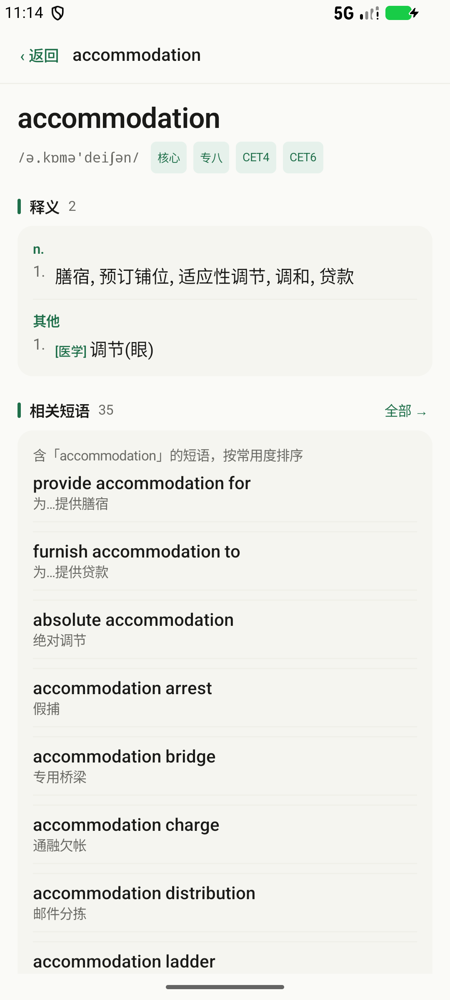 | 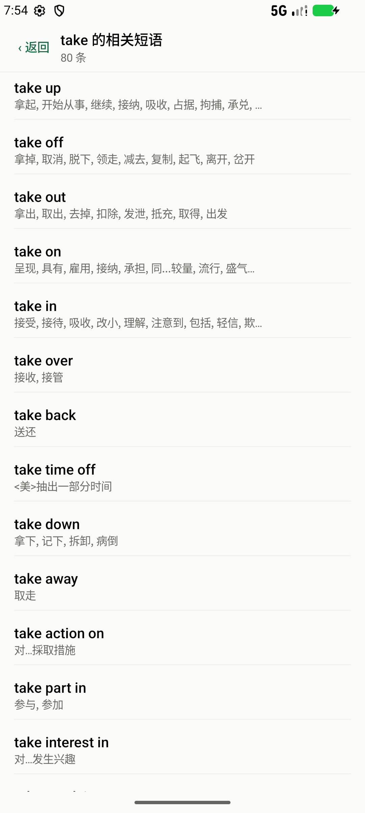 | 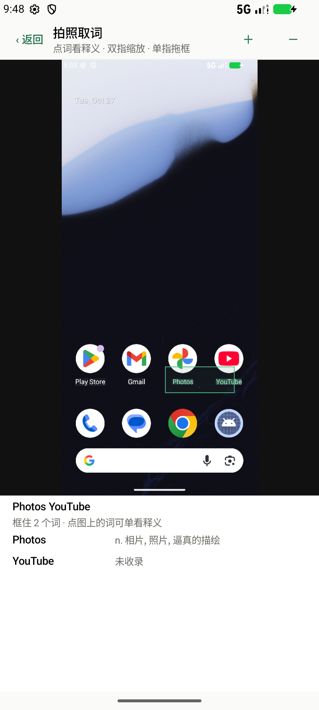 |

| 点词即查 | 夜间模式 | 应用图标 |
| --- | --- | --- |
| 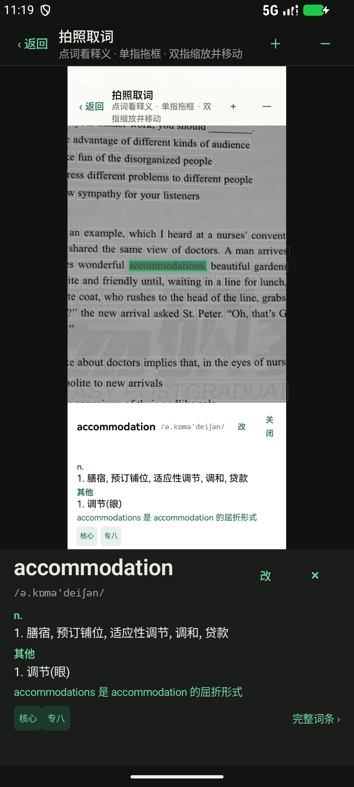 | 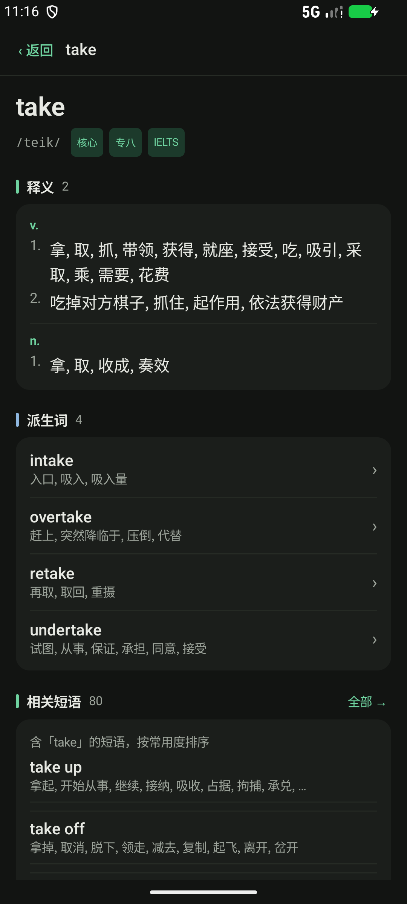 |  |

---

## 现在能做什么

| 能力 | 状态 | 说明 |
| --- | --- | --- |
| 离线查词 | ✅ | `.lexd` 包 + mmap + 前压缩块索引，JVM 实测 P95 **0.023ms** |
| 短语库 | ✅ | **12 万条** 2~4 词短语，全部带中文释义 |
| 词→短语关联 | ✅ | 查 `take` → 「相关短语 80 条」，`take up/off/out/on/in/over…` 按常用度排序 |
| 短语全列表 | ✅ | 词条页「查看全部 →」进入独立页，列出该词全部关联短语 |
| 短语详情 | ✅ | 点任一短语进入完整词条：多义项（take up 有 10 个义）、拆词可点回单词 |
| 词形还原 | ✅ | running→run、went→go、bigger→big、basically→basic |
| 派生剥离 | ✅ | 构建期派生表 + **运行期词缀实时拆解**：unaffordable → affordable，readability → readable |
| 派生词族 | ✅ | 词条页「派生词」栏：afford → affordable；派生词反向显示「源自 afford」 |
| 主题 | ✅ | 日间 / 夜间 / 跟随系统，点击胶囊切换并持久化；深色为独立色板而非反色 |
| 词条页分区 | ✅ | 「释义 / 例句 / 派生词 / 相关短语」各自成卡片，左侧色条 + 数量 + 右侧动作 |
| 源码标识符拆词 | ✅ | `getUserById` → get / User / By / Id |
| 拼写纠错 | ✅ | 编辑距离 ≤2，`idempotnet` → `idempotent` |
| 中文反查 | ✅ | 输入「幂等」→ idempotent |
| 拍照 / 相册取词 | ✅ | 系统相机或相册 → 本地 OCR → 点词即出释义 / 拖框批量选词 / 双指缩放移动 / **识别错了可改词重查** |
| 整句翻译（NMT） | ⬜ v0.3 | 见「下一步」 |
| 划词取词（其他 App 内） | ⬜ v0.3 | `ACTION_PROCESS_TEXT` |
| 生词本 | ⬜ v0.4 | — |

---

## 实测结果（v0.3.2）

| 项 | 结果 |
| --- | --- |
| 词条总数 | **133,079**（单词 13,079 + 短语 120,000） |
| 变形表 / 派生表 | 23,350 / 2,472 |
| 中文索引 | 28,672 |
| 词→短语关联 | 7,761 个词，177,890 条关联（每词最多 80 条） |
| 词库包体积 | **6.55 MB**（v0.1 无短语时 1.19MB） |
| 查词 P95 | **0.023 ms** |
| 端到端查询均值 | **0.286 ms**（含未命中、纠错、拆词路径） |
| 单测 | **38 个全绿**（morph 13 / dict 9 / search 16） |
| 权限 | **0 个**（无 INTERNET / CAMERA / 存储） |
| release APK | **19 MB**（arm64，含 OCR）；**7.8 MB**（不含 OCR） |

### 截图

| 搜索 take：相关短语 80 条 | 词条页：短语按常用度排序 |
| --- | --- |
| 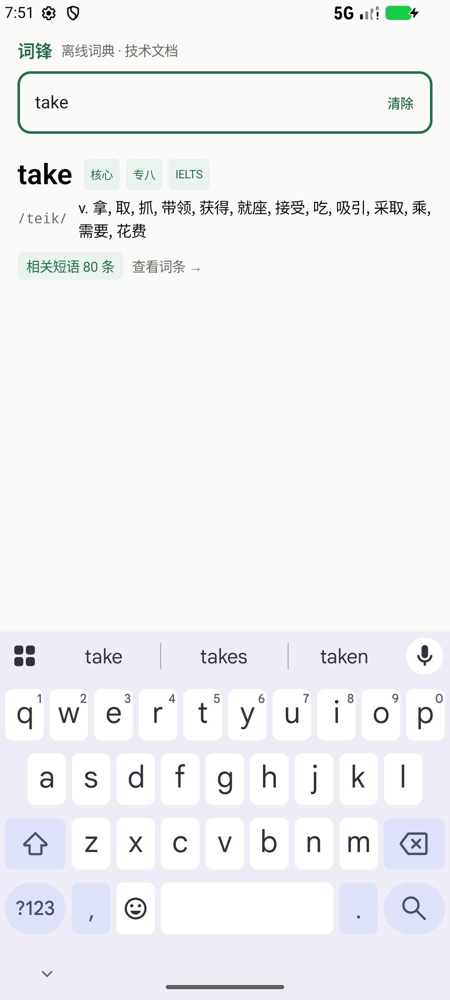 | 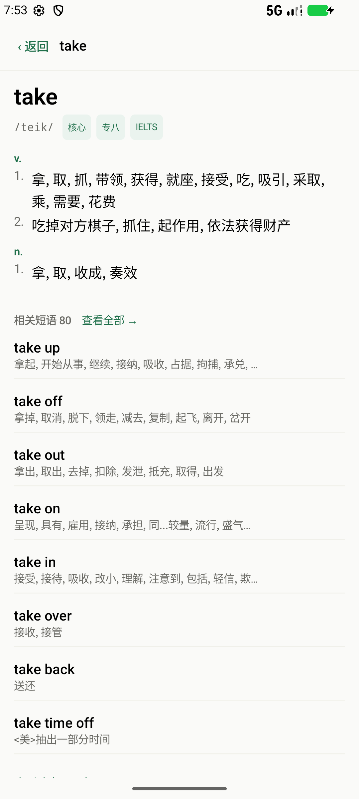 |

| 全部短语 | 短语详情（含拆词） |
| --- | --- |
|  | 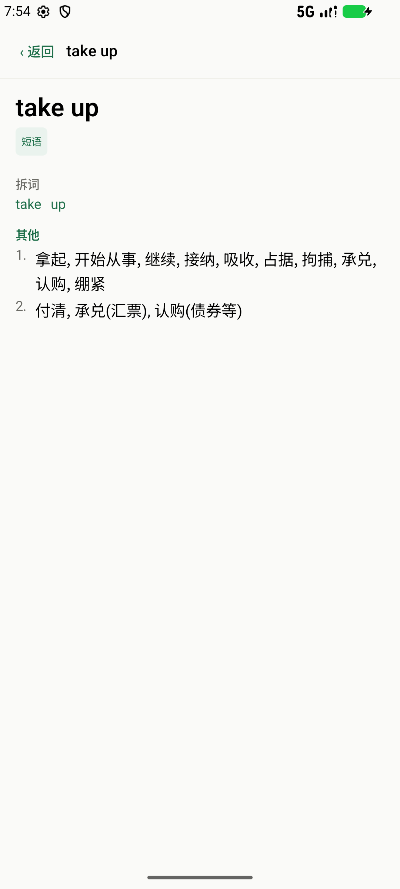 |

| 派生词族（afford → affordable） | 夜间模式 |
| --- | --- |
| 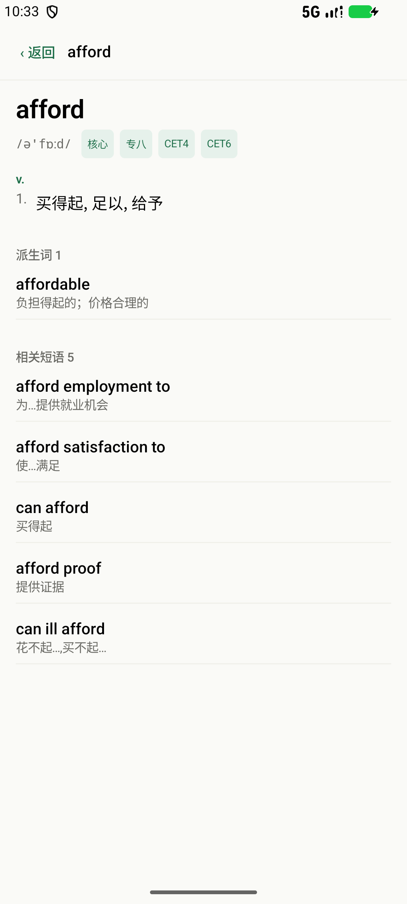 | 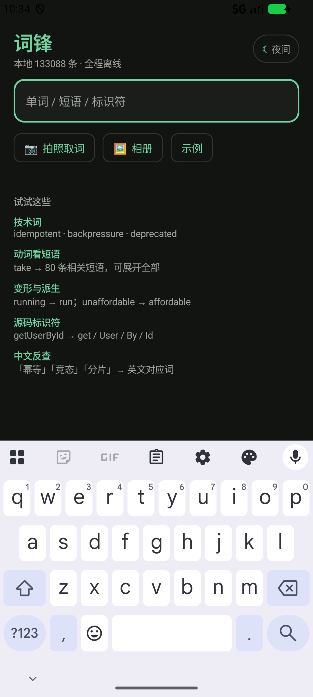 |

| 拍照取词：框选（只选中框内词） | 识别错了可以改词 |
| --- | --- |
|  | 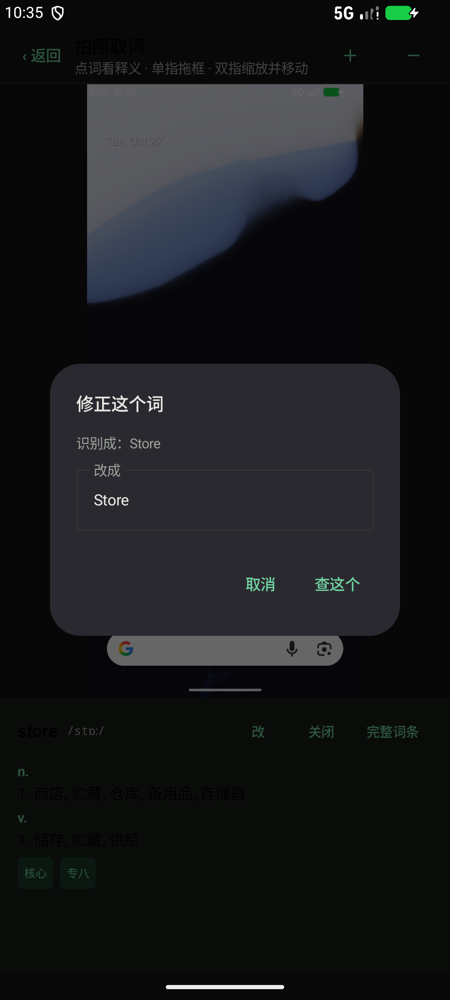 |

---

## 存储占用（实测）

同一份 release 构建，唯一差别是 OCR 依赖：

| 组成 | 体积 | 说明 |
| --- | --- | --- |
| 词库包（12 万短语） | 6.55 MB | 占 APK 约 1/3 |
| 应用代码 + Compose + 资源 | ≈ 1.3 MB | R8 后 |
| **release 无 OCR（arm64）** | **7.8 MB** | 只有查词与短语 |
| ML Kit OCR 原生库 | +9.5 MB | `libmlkit_google_ocr_pipeline.so`（arm64） |
| OCR 模型资源 | +1.0 MB | tflite / lstm 模型 |
| OCR 相关代码（dex，R8 后） | +0.7 MB | ML Kit 依赖已被大幅裁剪 |
| **release 含 OCR（arm64）** | **19 MB** | 完整功能 |

**结论：拍照取词让 APK 从 7.8MB 涨到 19MB（+11.2MB），是短语库（+5.4MB）的两倍。**

其中 9.5MB 是硬成本——ML Kit 的 OCR 是一条完整的「文字检测 + 行分割 + 识别」管线，光原生库就这么多，模型反而只有 1MB。

> 踩过一个坑：release 一度是 30MB，因为 `defaultConfig` 里的 `abiFilters` 会和 `buildTypes` 的**取并集**，导致 x86_64 的 OCR 原生库也被打进去（+11MB）。修法是只在 debug 里声明两个 ABI，release 只留 arm64。
>
> 另一个坑：ML Kit 的清单会把 `INTERNET` / `ACCESS_NETWORK_STATE` 合并进来，必须在 manifest 里用 `tools:node="remove"` 显式删掉。删掉后 OCR 依然正常（已实测），因为 bundled 模型完全本地。

### 三种可选策略

| 方案 | 体积 | 代价 |
| --- | --- | --- |
| **A. 单包全功能（当前）** | 19 MB | 简单，装完即用 |
| **B. 分两个包**：标准包 7.8MB / 完整包 19MB，同签名可覆盖安装 | 用户自选 | 商店要写清差异，避免"装了标准包发现不能拍照" |
| C. 换 ML Kit 非捆绑版（走 GMS 下载模型） | 8~9 MB | 首次使用必须联网由 GMS 下载 ~20MB，且必须装 GMS；破坏"零联网"承诺 |

**建议选 B**：默认给标准包，拍照功能作为"完整包"单独提供——和开发文档里"轻量包 / 标准包 / 完整包"的分包思路一致。

---

## 拍照取词怎么用

1. 首页右上角「拍照」拍一张，或「相册」选一张截图
2. 本地 OCR 识别（英文，约 0.5~1.5 秒），每个词都画出细框
3. 三种操作，互不干扰：
   - **单击某个词** → 下方直接出这个词的释义卡（音标 / 词性 / 前 3 个义项 / 等级标签），不跳页；要完整词条点右上「完整词条」
   - **单指拖动框选** → 只选中**框内**的词（按面积占比 ≥60% 判定），框外的词不会被带进来
   - **双指捏合 / 拖动** → 放大最多 6 倍并平移，方便对准小字；顶部还有 ＋ / － 按钮做精确微调

实现要点：

- **框选判定用面积占比而不是"擦到就选"**：词框有 ≥60% 落在选区内才算选中。这样窄框能精确圈住一个词，也不会因为手抖把旁边半个词带进来。
- **缩放时保持手指中心不动**：捏合时按质点缩放，视觉上不会"跑偏"；缩放会清空旧选区，避免坐标系错位后选中错误的词。

- **不需要 CAMERA 权限**：用 `ACTION_IMAGE_CAPTURE` 调系统相机，照片写进应用 cache（`FileProvider` 暴露），用完即弃，不落用户相册、不占长期存储。
- **不联网**：ML Kit 的 Latin 识别模型随 APK 打包（`com.google.mlkit:text-recognition` 的 bundled 版），首次使用无需下载。
- **大图降采样**：解码时按 `inSampleSize` 压到最长边 2200px，避免 4000 万像素照片 OOM。

---

## 从源码构建

```bash
make fetch-dict  # 下载 ecdict.csv（66MB，带断点续传）
make dict        # 生成词库包 L2.lexd（约 15 秒）
make test        # 43 个单测（纯 JVM，不需要设备）
make apk         # debug APK（arm64 + x86_64）
make release     # release APK（仅 arm64，R8 后约 19MB）
```

环境要求：**JDK 17**（不要用 21+，AGP 8.7 未适配）、Android SDK Platform 35 + Build-Tools 35.0.0、Python 3.10+。
`local.properties` 里写 `sdk.dir=<你的 SDK 路径>`（已 gitignore）。

`make dict` 依赖 `data/raw/ecdict.csv`（ECDICT，MIT，仓库不附带 66MB 原始数据）：

```bash
cd data/raw && bash fetch.sh
# 或
curl -L -C - -o data/raw/ecdict.csv \
  https://raw.githubusercontent.com/skywind3000/ECDICT/master/ecdict.csv
```

> `gradle-wrapper.properties` 里的 distributionUrl 指向腾讯云镜像（国内拉 Gradle 更快），
> 海外网络可改成 `https://services.gradle.org/distributions/gradle-8.14.3-bin.zip`。
> 依赖仓库同理：`settings.gradle.kts` 里 aliyun 镜像排在 google/mavenCentral 之前。

---

## 目录结构

```
LexForge/
├── app/                      # Android 壳（Compose UI）
│   ├── src/main/assets/      # L2.lexd（构建产物，6.5MB）
│   └── src/debug/assets/     # ocr_sample.png（仅 debug，用于验证 OCR 链路）
├── core/
│   ├── model/                # 纯 Kotlin 数据模型与接口
│   ├── dict/                 # LEXD 读取器：mmap、块二分、zlib、LRU
│   ├── morph/                # 词形还原、标识符拆词
│   └── search/               # 归一化、五级检索、纠错、反查、短语关联
├── tools/                    # 词库流水线（Python）
│   ├── lexd.py               # 格式读写（唯一权威定义）
│   ├── build_dict.py         # ECDICT + 术语表 → L2.lexd（含短语挖掘）
│   └── inspect_pack.py       # 包自检 + 查询基准
└── data/tech/glossary.tsv    # 技术术语表（248 条，人工维护）
```

---

## 短语库是怎么来的

ECDICT 里有 36.7 万条多词条目，但质量参差（含大量专名、歌名、机翻）。挖掘规则：

1. **限定 2~4 词**，只含 `[a-z' -]`，无数字
2. **每个 token 必须在 13k 核心词表内**，或属于 56 个功能词（a/the/to/up/of…）
3. **必须有中文释义**
4. 排序信号：首词是动词（查 ECDICT 的 `pos` 字段词性占比）> 末词是常用小词（up/off/out/on/in…）> 最生僻 token 的词频 > 长度 / 是否网络词典 / 首字母大写（专名惩罚）

结果：36.7 万 → 通过质量门槛 13.1 万 → 取前 12 万。这样 `take` 的第一屏是 `take up / take off / take out / take on / take in / take over / take back`，而不是 "cash take" 这种怪条目。

关联索引（词 → 短语）在构建期算好，写进 `REL` 段，运行时是一个 HashMap 查表，不做全量扫描。

---

## 与开发文档的差异（务实取舍）

1. 去掉 bucket 两级索引，直接对块全局二分（代码少一半）
2. 压缩用 zlib（JDK 内置）而非 zstd，省 7MB 原生库；`algo` 字段已预留
3. 词条载荷用 `\x01` 分隔行格式，不用 JSON（快 3 倍、小 20%、零依赖）
4. 新增 `REL` 段（词→短语），格式版本仍是 v1，旧读取器忽略未知段即可
5. OCR 用 ML Kit bundled 版，代价是 +22MB —— 这是 v0.2 最大的一笔体积支出

---

## 词库是怎么补齐"查不到"的

之前 `affordable` 有、`unaffordable` 没有——因为构建期的派生表只覆盖"两个词都收录"的情况，词典里没有 unaffordable，就永远查不到。

现在两层解决：

1. **运行期词缀拆解**（`core/morph/Derivation.kt`）：先剥后缀（`-ability` 还原成 `able`，所以 readability → readable 而不是 read），再剥前缀（`un-`），最多两层，拆出来的词必须在库里存在才采用。
2. **高频派生词直接入典**：`data/tech/glossary.tsv` 补了 affordable / unaffordable / readability / reusability 等 16 条，释义人工写成"能读进句子"的样子（"负担得起的；价格合理的"，而不是 ECDICT 里那句"普及型"）。

命中后会明确标注，不做无声替换：

> unaffordable 可能是 un- + affordable，词典未单列该派生词

## 词条页的信息层级

一屏里同时有释义、例句、派生词、相关短语，如果只是平铺，用户分不清哪一行属于哪个区块。现在按卡片分区：

```
▎释义 2                    ← 绿色竖条 + 数量
┌──────────────────────────┐
│ v.  1. 拿,取,抓 …         │  ← 浅底圆角卡片
│ n.  1. 拿,取,收成 …       │
└──────────────────────────┘

▎派生词 4                  ← 蓝色竖条（与短语区分）
┌──────────────────────────┐
│ intake        入口…     › │
│ overtake      赶上…     › │
└──────────────────────────┘

▎相关短语 80          全部 →  ← 绿色竖条 + 数量 + 动作
┌──────────────────────────┐
│ take up   拿起,开始从事…  │
└──────────────────────────┘
```

- 派生词用**蓝色**竖条（secondary），短语用**绿色**（primary），颜色本身就能区分
- 行内容收进卡片，不再散落在页面背景上
- 派生词最多展示 12 条，超出显示"还有 N 个派生词"

## 长词排版

`accommodation` 这种长词原来会把右侧的「改 / 关闭 / 完整词条」挤成竖排（"关"和"闭"各占一行）。现在：

- 词与音标独占一列，最多两行，超长省略号截断
- 右上角只留紧凑的「改」「×」
- 「完整词条 ›」移到下方标签行右端

## 主题是怎么判断的

三态循环，右上角胶囊点击切换：

| 模式 | 判断依据 |
| --- | --- |
| 跟随系统 | `isSystemInDarkTheme()`，即系统「设置 → 显示 → 深色主题」开关；多数 ROM（含 Pixel）支持设成「按日出日落自动」，那是系统在做，本应用只读结果 |
| 日间 | 强制浅色，忽略系统 |
| 夜间 | 强制深色 |

胶囊上的图标显示**当前实际生效**的明暗（跟随时会随系统变成 ☀ 或 ☾），不是固定的圆点。

**深色下黑字黑底的成因**：Compose 里 `Text` 不指定颜色时取 `LocalContentColor`，它的默认值是纯黑。根节点原来只有 `Box(background=...)`，没有提供内容色，于是深色模式就成了黑底黑字。修法是在主题里用 `Surface(color = background, contentColor = onBackground)` 包一层，同时把 Activity 窗口主题换成 `values-night` 变体，状态栏图标也按当前明暗切换。

## 下一步

1. **划词取词**（`ACTION_PROCESS_TEXT` + 半屏浮层）：最高频入口，且**不增加包体**
2. **整句翻译**（opus-mt int8）：+82MB，必须分包
3. **分包**：standard（7.8MB）/ full（30MB）/ full+翻译（112MB）
4. **专八词表**：三源交叉 + 5% 人工抽检，替换当前的近似选取

---

## 许可与数据来源

- 词典数据：ECDICT（MIT），释义经本项目重排
- 技术术语表：自建
- OCR：Google ML Kit Text Recognition（bundled），遵循其许可
- 翻译模型（v0.3 引入）：Helsinki-NLP/opus-mt（CC BY 4.0）

应用不收集任何用户数据，不请求网络权限。
